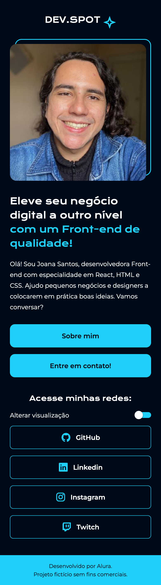
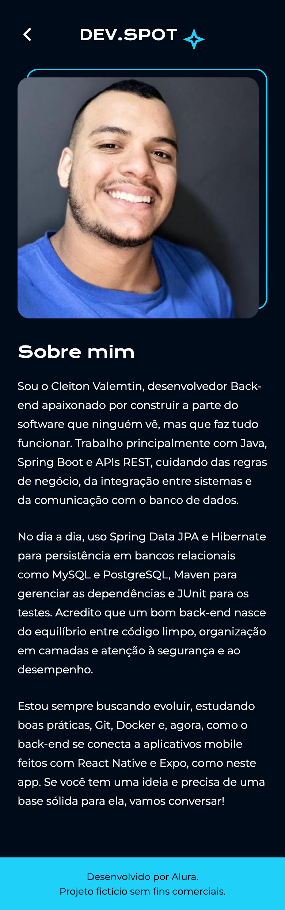
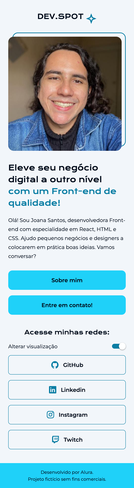

# DEV.SPOT

Aplicativo mobile desenvolvido com **Expo + React Native** como trabalho prático da disciplina de Tópicos Especiais.

O app apresenta o portfólio de uma desenvolvedora Front-end em duas telas:

- **Home** — logo, foto de perfil, texto de apresentação, botões "Sobre mim" e "Entre em contato!", switch de visualização e links para as redes sociais (GitHub, LinkedIn, Instagram e Twitch).
- **Sobre mim** — biografia completa e rodapé com créditos.

## Integrantes

| Nome | GitHub |
| ---- | ------ |
| Calebe Sousa de Araujo | [@Calebe-Dev](https://github.com/Calebe-Dev) |
| Cleiton Valemtin | [@Cleiton-code](https://github.com/Cleiton-code) |

## Prints das telas

| Home | Sobre mim | Home (tema claro) |
| :--: | :-------: | :---------------: |
|  |  |  |

## Funcionalidades

- **Sobre mim:** navega para a segunda tela (com botão de voltar no topo).
- **Entre em contato!:** mostra um alerta com a mensagem "Entre em contato".
- **Alterar visualização:** o switch mostra o alerta "Switch pressionado" e alterna entre os temas escuro e claro.
- **Redes sociais:** cada botão abre o link da rede no navegador.
- **Animações:** o conteúdo das telas aparece com fade + deslize e os botões encolhem levemente ao serem pressionados.
- **Responsividade:** o conteúdo tem largura máxima e fica centralizado em telas grandes (tablets e web); a imagem se ajusta à largura da tela.

## Sobre a atividade

Trabalho prático em dupla: desenvolver um app mobile com Expo + React Native que reproduza as duas telas do layout fornecido, praticando estruturação de componentes, estilização, navegação entre telas e organização de projeto. Não é preciso copiar cores e fontes exatamente, mas a estrutura, a hierarquia de informação e os elementos das telas devem ser mantidos.

### Tela 1 – Home

- [x] Logo ou nome do app no topo
- [x] Imagem de perfil (ou ilustrativa)
- [x] Texto de apresentação (título + descrição)
- [x] Botão **"Sobre mim"** → leva para a segunda tela
- [x] Botão **"Entre em contato!"** → mostra um Alert com a mensagem "Entre em contato"
- [x] Seção "Acesse minhas redes" com botões para GitHub, LinkedIn, Instagram e Twitch
- [x] Switch que mostra um Alert com a mensagem "Switch pressionado"

### Tela 2 – Sobre mim

- [x] Título "Sobre mim"
- [x] Texto descritivo (biografia/apresentação)
- [x] Layout organizado com boa legibilidade
- [x] Rodapé com créditos

### Requisitos técnicos

- [x] Desenvolvido com Expo e React Native
- [x] Componentes reutilizáveis
- [x] Estilização com `StyleSheet`
- [x] Organização de pastas (`src/screens`, `src/components`, `src/assets`)

### Diferenciais (opcionais)

- [x] Animações simples
- [x] Dark mode / alternância de tema
- [x] Ícones personalizados (logos das redes e estrela do logo, nas cores do tema)
- [x] Links reais abrindo redes sociais
- [x] Responsividade

### Entrega

- [x] Repositório no GitHub com o projeto completo
- [x] README com nome dos integrantes, descrição do app, prints das telas e como rodar o projeto
- [ ] Link do repositório enviado na atividade

## Tecnologias

- [Expo](https://expo.dev/)
- [React Native](https://reactnative.dev/)
- [React Navigation](https://reactnavigation.org/) (native stack)
- [@expo/vector-icons](https://icons.expo.fyi/)
- [Expo Google Fonts](https://github.com/expo/google-fonts) (Krona One e Montserrat)

## Estrutura de pastas

```
├── App.js                  # Carrega as fontes e monta o tema + navegação
├── assets/                 # Ícone e splash do app
├── docs/prints/            # Prints usados neste README
└── src/
    ├── assets/images/      # Imagens usadas nas telas
    ├── components/         # Componentes reutilizáveis
    │   ├── Button.js           # Botão preenchido ou com borda, com ícone opcional
    │   ├── FadeInView.js       # Animação de entrada do conteúdo
    │   ├── Footer.js           # Rodapé com créditos
    │   ├── Header.js           # Logo DEV.SPOT (e botão de voltar)
    │   ├── ProfileImage.js     # Foto com moldura deslocada
    │   ├── ScreenContainer.js  # Estrutura comum das telas (rolagem + rodapé)
    │   └── ToggleRow.js        # Texto + switch
    ├── contexts/           # Contexto do tema claro/escuro
    ├── data/               # Textos do perfil e links das redes
    ├── navigation/         # Rotas (stack navigator)
    ├── screens/            # Telas Home e Sobre mim
    ├── theme/              # Cores dos temas e fontes
    └── utils/              # Alerta e configuração de animação
```

## Como rodar o projeto

Pré-requisitos: [Node.js](https://nodejs.org/) instalado e o app **Expo Go** no celular (ou um emulador Android/iOS).

```bash
# clonar o repositório
git clone https://github.com/Calebe-Dev/devspot-app.git
cd devspot-app

# instalar as dependências
npm install

# iniciar o servidor de desenvolvimento
npx expo start
```

Depois, escaneie o QR Code com o Expo Go (Android) ou com a câmera (iOS). Também é possível pressionar `a` para abrir no emulador Android, `i` para o simulador iOS ou `w` para abrir no navegador.
